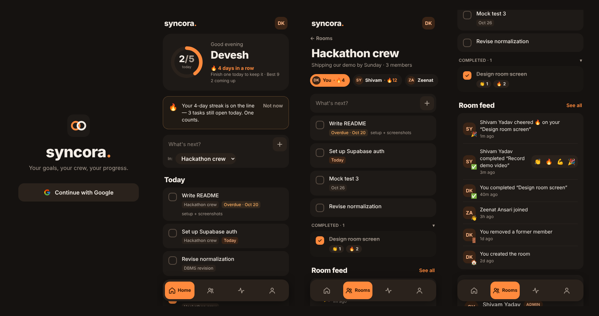
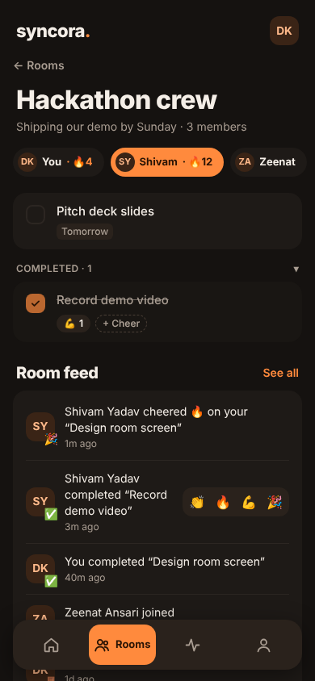
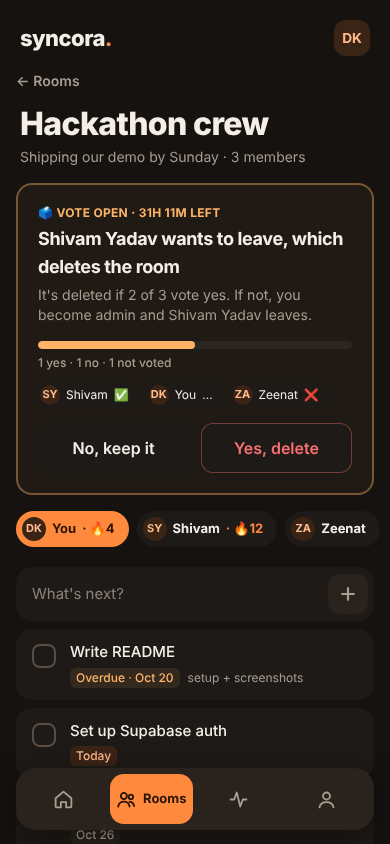
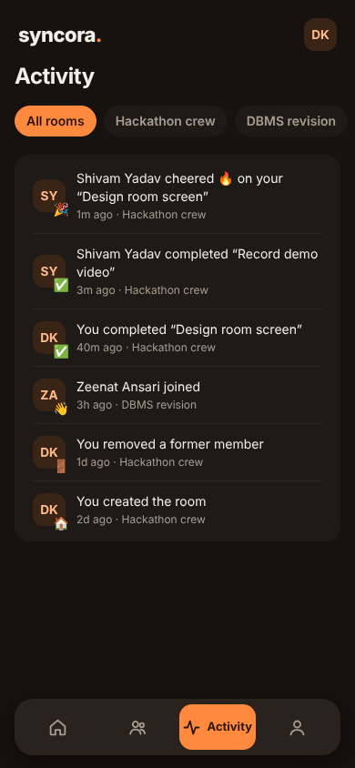
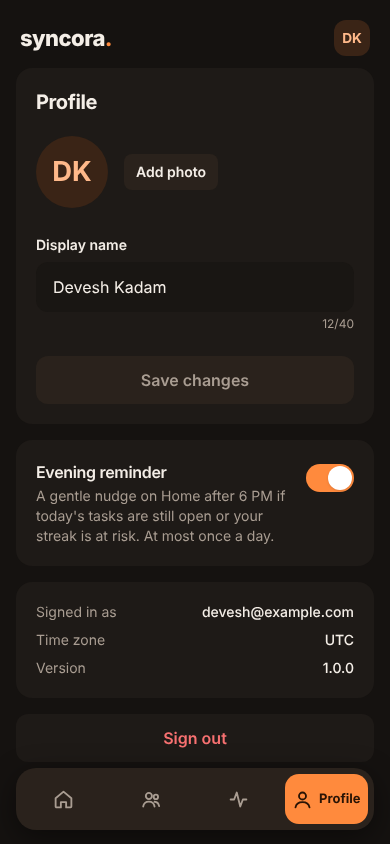

<div align="center">


# syncora.

**Your goals, your crew, your progress.**

A mobile-first shared productivity app for people working toward the same goal.
Everyone keeps their own task list, the whole room can see who's done what, and teammates cheer each other on.

React 19 · Vite · Tailwind CSS v4 · Supabase (Postgres, Auth, RLS, Realtime) · PWA · Vercel

</div>



---

## Why

Study groups, hackathon teams and side-project crews usually plan separately even when they share a goal. Nobody knows what the others are working on or what's already done. Full project-management tools are overkill for that.

Syncora sits in between: **individual ownership, shared visibility, friendly accountability.** You only ever edit your own tasks, but your room sees your progress, and a checkmark is enough to get a 🔥 from a friend.

## Features

**Rooms**
- Create a room for a shared goal, invite people with an 8-character code or a join link (look-alike characters like `0/O` and `1/l` are left out)
- Up to 20 members per room; join as many rooms as you like
- The admin can rename the room, regenerate the code, and remove members

**Tasks**
- Add tasks with an optional due date (Today / Tomorrow / pick a date) and notes
- Everyone in the room sees everyone's tasks and status; only the owner can change them
- Overdue tasks are flagged and float to the top

**Home dashboard**
- Today's tasks from *all* your rooms, tagged by room, with a "2/5 today" progress ring
- "Coming up" for future-dated work, room shortcuts, and recent activity

**Motivation, not pressure**
- **Streaks:** one completed task per local day keeps it going (rules below)
- **Cheers:** react 👏 🔥 💪 🎉 to a teammate's completed task, right on the task or from the room feed
- **Evening reminder:** a gentle in-app nudge after 6 PM if today's tasks are still open or your streak is at risk. Once a day, and you can switch it off
- No leaderboards, no points

**Fair room deletion**
- An admin alone in a room can delete it instantly
- Otherwise the room **votes** for 48 hours: it's deleted only if more than half say yes
- If an admin wants to *leave* and the vote fails, admin passes to the longest-standing member

**Shared room calendar**
- Every room has a **Tasks | Calendar** tab: a month view with dots on busy days; tap a day → **Add event** (title, description, date, time or all-day, reminder)
- Anyone in the room can add events; the creator and the admin can edit or delete them
- **Reminders as real push notifications** (at start, 10 min, 1 hour or 1 day before; all-day events at 9 AM), even with the app closed; tapping one opens that day in the room's calendar. Anyone can mute a room's reminders
- **Upcoming** events across all your rooms on Home; new events show in the room feed

**Easy to start**
- The sign-in page explains the app in three lines; people arriving from an invite link see *"You've been invited to a room"*
- A 4-card **"How Syncora works"** tour after the first sign-in (skippable, replayable from Profile), ending in *Create a room* / *Join with a code*, or straight into the room they were invited to
- A self-ticking **Getting started** checklist on Home until the first task is done, and an **Invite your crew** card while you're alone in a room

**Live and installable**
- Every screen updates in real time when someone else changes something
- Installable as an app on Android, iPhone and desktop; opens offline with a clear "you're offline" strip
- Google sign-in

<table>
  <tr>
    <td align="center"><br /><sub>Member tabs with streaks</sub></td>
    <td align="center"><br /><sub>Deletion vote</sub></td>
    <td align="center"><br /><sub>Activity feed</sub></td>
    <td align="center"><br /><sub>Profile &amp; reminder</sub></td>
  </tr>
</table>

---

## Tech stack

| Layer | Choice | Why |
|---|---|---|
| Frontend | React 19 + Vite 8, React Router 7 | Fast dev loop, simple SPA |
| Styling | Tailwind CSS v4 with design tokens | One file (`src/index.css`) controls the whole theme |
| Auth | Supabase Auth (Google OAuth) | No passwords to manage |
| Database | Supabase Postgres | Relational data: rooms ↔ members ↔ tasks |
| Permissions | Postgres **Row-Level Security** + `security definer` functions | Rules are enforced in the database, not just hidden in the UI |
| Realtime | Supabase Realtime (`postgres_changes`) | Live updates that respect RLS |
| Storage | Supabase Storage (`avatars` bucket) | Profile photos, cropped to 256 px on the device first |
| App shell | PWA manifest + small service worker | Home-screen install, offline open |
| Reminders | Web Push (VAPID) + Supabase Edge Function + pg_cron | Notifications with the app closed, no extra server |
| Hosting | Vercel | Static build, SPA rewrites |

There is **no custom backend server**. The browser talks to Supabase directly, and everything sensitive (joining, removing members, voting, completion timestamps, streaks) runs inside Postgres.

## How it works

### Data model

```
profiles ──< room_members >── rooms ──< deletion_requests ──< deletion_votes
    │                           │
    └──────────< tasks >────────┘
                   │
                   ├──< reactions
                   └──< activity_events
```

| Table | Holds |
|---|---|
| `profiles` | Display name, avatar, time zone, reminder setting (created automatically on first sign-in) |
| `rooms` | Name, description, admin, join code |
| `room_members` | Who is in which room, and since when |
| `tasks` | Title, notes, due date, `completed_at` (`null` = pending) |
| `reactions` | One row per person per emoji per task |
| `activity_events` | The room feed: completions, cheers, joins, leaves, votes |
| `deletion_requests`, `deletion_votes` | Open/closed room-deletion votes |
| `room_events` | Calendar events: title, description, start, all-day, reminder offset + computed `remind_at` |
| `push_subscriptions` | One row per device that turned reminders on |

### Security model

All tables have RLS on. Highlights:

- **Rooms are invisible to non-members:** their tasks, members, feed and votes included. Profiles are visible only to people you share a room with.
- **Only the owner can write a task**, enforced with RLS plus column-level grants (a task can't be moved to another room or handed to someone else).
- **`completed_at` is set by the server clock**, so a completion can't be backdated to fake a streak.
- **Joining, leaving, removing, voting and deleting** go through `security definer` functions that check permissions, the 20-member cap (with a row lock so two people can't join at the same moment), and vote rules.
- The admin **can't remove members while a vote is open**, so "no" voters can't be kicked out.
- Avatar uploads are limited to the user's own storage folder, images only, 2 MB max.

### Streak rule

- A day counts when you complete **at least one task** on that **local calendar day** (your profile's time zone).
- Your streak stays alive until midnight, even before you've done anything today.
- Unchecking or deleting a completed task removes its credit. The streak is **calculated on the fly, never stored**.
- One global streak across all rooms.

### Realtime

Each screen subscribes to the tables it shows (`useLiveRefresh`), waits ~350 ms to batch bursts, then quietly refetches. It also refetches when the tab regains focus or the device comes back online, so a phone that slept catches up.

---

## Getting started

### Prerequisites
- Node.js 20.19+ or 22.12+ (required by Vite 8)
- A free [Supabase](https://supabase.com) project
- A Google Cloud project, for the OAuth client

### 1. Install

```bash
git clone https://github.com/Devesh-cyber/syncora.git
cd syncora
npm install
cp .env.example .env.local
```

Fill in `.env.local` from Supabase → **Project Settings → API**:

```env
VITE_SUPABASE_URL=https://<project-ref>.supabase.co
VITE_SUPABASE_ANON_KEY=<anon public key>
VITE_VAPID_PUBLIC_KEY=<optional, for calendar push — see docs/REMINDERS_SETUP.md>
```

### 2. Set up the database

In Supabase → **SQL Editor**, run each file in `supabase/migrations/` **in order**:

| File | Adds |
|---|---|
| `002_profiles.sql` | Profiles, signup trigger, avatars bucket |
| `003_rooms.sql` | Rooms, members, join codes, activity log |
| `004_tasks.sql` | Tasks and their rules |
| `006_reactions_streaks.sql` | Cheers and streak functions |
| `007_deletion_votes.sql` | Room deletion votes |
| `008_realtime.sql` | Realtime publication |
| `009_onboarding.sql` | "Tour seen" flag for the welcome tour |
| `010_calendar.sql` | Room calendar, reminders, push subscriptions |

**Calendar push reminders** need a little more one-time setup (VAPID keys, an Edge Function and a 1-minute schedule). Follow [`docs/REMINDERS_SETUP.md`](docs/REMINDERS_SETUP.md). The calendar works without it; reminders then only show while the app is open.

The numbers follow the build phases; phases 1 and 5 needed no SQL, so there are no 001 or 005 files. Optional: the last lines of `007_deletion_votes.sql` show how to close expired votes in the background with `pg_cron`. Without it, a vote is settled when someone next opens the room.

### 3. Enable Google sign-in

1. **Google Cloud Console → APIs & Services → Credentials →** create an **OAuth client ID** (Web application).
   - Authorized redirect URI: `https://<project-ref>.supabase.co/auth/v1/callback`
2. **Supabase → Authentication → Sign In / Providers → Google:** enable it and paste the client ID and secret.
3. **Supabase → Authentication → URL Configuration:**
   - Site URL: `http://localhost:5173`
   - Redirect URLs: `http://localhost:5173/**`

While the OAuth consent screen is in *Testing* mode, add each person who'll sign in as a test user, or publish the app (basic profile/email scopes don't need Google review).

### 4. Run

```bash
npm run dev       # http://localhost:5173
npm run build     # production build in dist/
npm run preview   # serve the build (service worker active)
```

## Deploying to Vercel

1. Push the repo to GitHub and import it on [Vercel](https://vercel.com). The **Vite** preset is detected automatically.
2. Add `VITE_SUPABASE_URL` and `VITE_SUPABASE_ANON_KEY` under **Settings → Environment Variables**, then deploy.
3. In Supabase → **Authentication → URL Configuration**, set the Site URL to your Vercel URL and add `https://<your-app>.vercel.app/**` to Redirect URLs.

`vercel.json` already handles deep-link refreshes, keeps `sw.js` uncached, and caches hashed build assets for a year.

---

## Project structure

```
src/
├── pages/                 One file per screen (Home, Rooms, RoomDetail, Activity, Profile, SignIn, …)
├── components/
│   ├── tasks/             RoomTasks (member tabs), TaskItem, TaskComposer, TaskEditor, ReactionBar
│   ├── Layout.jsx         Wordmark header + floating pill nav
│   ├── VotePanel.jsx      Open deletion vote: tally, voters, Yes/No
│   ├── RoomActivity.jsx   Room feed with one-tap Cheer
│   └── …                  Avatar, dialogs, sheets, install card, reminder, offline strip, error boundary
├── context/AuthContext.jsx   Session + profile (useAuth)
├── lib/                   Supabase queries per feature, dates, realtime hook, PWA helpers
└── index.css              Tailwind + "Ember" design tokens
supabase/migrations/       SQL, run in order
public/                    Manifest, icons, service worker
docs/                      Screenshots and the phase-by-phase build log
```

## Theming

The UI uses the **Ember** dark theme: warm charcoal, an ember-orange accent, Bricolage Grotesque headings and Inter body text. Every colour is a token in the `@theme` block of `src/index.css` (`canvas`, `surface`, `sunken`, `raised`, `ink`, `muted`, `line`, `brand`, `on-brand`, `warn`, `danger`, …), so changing a value there restyles the whole app.

## Roadmap

Deliberately left out of V1, possibly later depending on how the pilot goes:

- Private tasks and per-task visibility
- Recurring tasks and repeating calendar events (e.g. "daily revision", "every Monday standup")
- Comments on tasks
- Weekly progress summaries

## How it was built

Syncora was built in nine phases, each ending in a working, tested checkpoint: setup → auth → rooms → tasks → dashboards → cheers & streaks → deletion votes → realtime → PWA & deploy. Every SQL migration was tested against Postgres with Supabase-style roles, covering both the allowed and the blocked actions. The full log, with each phase's checklist, is in [`docs/BUILD_LOG.md`](docs/BUILD_LOG.md).

---

<div align="center">
Made by <a href="https://github.com/Devesh-cyber">Devesh Kadam</a>
</div>
